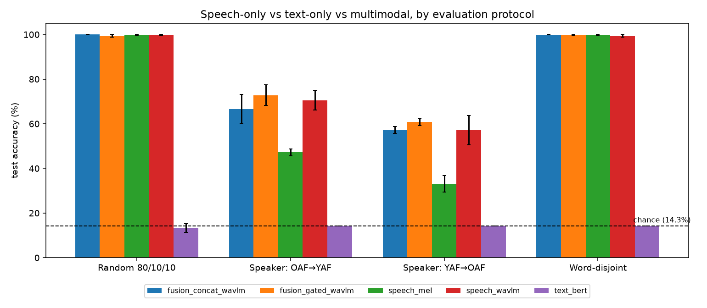

# Assignment 2b: Multimodal Emotion Recognition (TESS)

Speech-only, text-only and multimodal (speech + text) emotion classifiers on the Toronto Emotional
Speech Set, each built from the five functional blocks in the brief.

**Report:** [`report/Assignment_2b_Report.pdf`](report/Assignment_2b_Report.pdf) ·
**Tables:** [`Results/accuracy_tables.md`](Results/accuracy_tables.md) ·
**Plots:** [`Results/plots/`](Results/plots/)

## Architecture

| Block | Speech pipeline | Text pipeline |
|---|---|---|
| 1. Preprocessing | resample 24.4 kHz → 16 kHz mono, trim silence (`top_db=30`), peak-normalize, crop to 3 s | lower-case, BERT WordPiece tokenization (`[CLS] say the word … [SEP]`) |
| 2. Feature extraction | frozen **WavLM-Base+**, layer 9 → (frames × 768) at 50 fps; log-mel (frames × 80) as a baseline | frozen **bert-base-uncased** last layer → (tokens × 768) |
| 3. Temporal / contextual modelling | LayerNorm + linear 768→256 → **2-layer BiGRU** → **attention pooling** | linear 768→256 → **2-layer Transformer encoder** (4 heads) → masked mean pooling |
| 4. Fusion | **gated fusion**: `g = σ(W[s; t])`, `f = g ⊙ s + (1 − g) ⊙ t` (concatenation as baseline) | |
| 5. Classifier | MLP 256 → 256 → 7 (GELU, dropout 0.3) | |

Training: AdamW (lr 3e-4, weight decay 0.01), one-cycle schedule, batch 32, label smoothing 0.05,
up to 40 epochs with early stopping on validation accuracy (patience 8), random time-crop augmentation
for speech. Every result is the mean ± std over 3 seeds.

## Evaluation protocols

TESS has only **2 speakers** (OAF, YAF), and every sentence is the carrier phrase **"Say the word ___"**
with 200 target words, each spoken in all 7 emotions. A random split therefore puts the same speaker
*and* the same words in both train and test. We report four protocols:

| Split | Train | Test | What it measures |
|---|---|---|---|
| `random` | 80 % stratified | 10 % | standard (optimistic) benchmark |
| `speaker_oaf2yaf` | all OAF | all YAF | generalization to an unseen speaker |
| `speaker_yaf2oaf` | all YAF | all OAF | the reverse direction |
| `word_disjoint` | 70 % of words | 20 % of words (unseen) | no lexical overlap |

## Repository layout

```
assignment_2b/
├── models/
│   ├── common/            data.py (loading, splits) · features.py (blocks 1-2) · nets.py (blocks 3-5)
│   │                      engine.py (training / testing loop)
│   ├── speech_pipeline/   train.py · test.py
│   ├── text_pipeline/     train.py · test.py
│   └── fusion_pipeline/   train.py · test.py
├── Results/
│   ├── accuracy_tables.md     accuracy and macro-F1 for all model variants × splits, gate values, silhouette
│   ├── all_runs.csv           every run (model, split, seed, accuracy, macro-F1, gate)
│   ├── failure_cases.md       most confident errors + most frequent confusions
│   ├── plots/                 accuracy_by_split, confusion_*, tsne_speaker_oaf2yaf
│   └── make_results.py
├── runs/<model>/<split>/seed<k>/   metrics.json, history.json (checkpoints not committed)
├── report/                         PDF report
├── run_all.ps1                     reproduces everything
└── requirements.txt
```

## Setup

```bash
conda create -n ser python=3.11 -y
conda activate ser
pip install torch==2.5.1 torchaudio==2.5.1 --index-url https://download.pytorch.org/whl/cu121
pip install -r requirements.txt
```

**Data.** Download TESS (Kaggle: "Toronto emotional speech set (TESS)", or the University of Toronto
Dataverse, doi:10.5683/SP2/E8H2MF) and unzip it anywhere under `assignment_2b/data/`. The loader finds
`OAF_*` / `YAF_*` wav files recursively, de-duplicates the nested copy in the Kaggle archive, and handles
the mis-named `OA_bite_neutral.wav`.

## Run

All commands are run from `assignment_2b/`.

```bash
python -m models.common.features                     # blocks 1-2, cached to cache/ (~5 min on GPU)

python -m models.speech_pipeline.train               # all 4 splits x 3 seeds
python -m models.speech_pipeline.test
python -m models.speech_pipeline.train --speech_feat mel   # log-mel baseline
python -m models.speech_pipeline.test  --speech_feat mel
python -m models.text_pipeline.train
python -m models.text_pipeline.test
python -m models.fusion_pipeline.train --fusion gated
python -m models.fusion_pipeline.test  --fusion gated
python -m models.fusion_pipeline.train --fusion concat
python -m models.fusion_pipeline.test  --fusion concat

python Results/make_results.py                       # tables + plots
```

Options: `--splits random speaker_oaf2yaf …`, `--seeds 0 1 2`, `--epochs 40`. On one RTX 4050 the full
sweep (60 runs) takes about 25 minutes.

## Results

Test accuracy (%), mean ± std over 3 seeds:

| Model | Random | Speaker OAF→YAF | Speaker YAF→OAF | Word-disjoint |
|---|---|---|---|---|
| Speech: log-mel + BiGRU | 99.8 ± 0.2 | 47.2 ± 1.5 | 33.1 ± 3.7 | 99.8 ± 0.2 |
| **Speech: WavLM + BiGRU** | 99.9 ± 0.2 | 70.5 ± 4.4 | 57.1 ± 6.5 | 99.5 ± 0.6 |
| **Text: BERT + Transformer** | 13.3 ± 2.0 | 14.3 ± 0.0 | 14.3 ± 0.0 | 14.3 ± 0.0 |
| Fusion: concat | 100.0 ± 0.0 | 66.6 ± 6.6 | 57.2 ± 1.6 | 99.9 ± 0.1 |
| **Fusion: gated** | 99.4 ± 0.5 | **72.8 ± 4.6** | **60.8 ± 1.6** | 99.8 ± 0.2 |



Key findings (details in the report):

1. **Random and word-disjoint splits are saturated** (≥ 99.5 %) for every speech model. They cannot tell
   models apart, because the same two speakers appear in train and test.
2. **Text-only is at chance (14.3 %)** on every split. Every TESS transcript is "Say the word X" and each
   word occurs in all 7 emotions, so the text contains no emotion information. Its learned
   representation is almost constant (silhouette ≈ 0).
3. **Speaker-independent evaluation is the real test:** WavLM features beat log-mel by 23–24 points.
   Gated fusion gains +2–4 points over speech-only, within about one standard deviation, and concatenation does
   not help. The fusion model effectively ignores the text: the text embedding varies 13× less than the
   speech embedding, and the gate is nearly constant (0.61 ± 0.01).
4. **Easiest emotions:** fear, neutral, disgust (≥ 90 % cross-speaker). **Hardest:** happy and angry
   (8–29 %). They are mostly confused with each other and with disgust, because these high-arousal emotions
   are expressed in a speaker-specific way.
5. t-SNE shows that unseen-speaker emotions still form clean clusters (silhouette 0.37–0.46). The errors come
   from whole clusters being mapped to the wrong label (speaker shift), not from overlapping classes.
6. **Modality ablation** ([`Results/modality_ablation.md`](Results/modality_ablation.md)): shuffling the text
   across test clips leaves fusion accuracy unchanged (72.8 → 72.8 %), while shuffling the speech drops it to
   chance (≈ 13 %). The fusion models use speech only.
7. **Few-shot recalibration** ([`Results/fewshot_recalibration.md`](Results/fewshot_recalibration.md)): with the
   encoder frozen, refitting the classifier on **1 labelled clip per emotion** of the new speaker lifts accuracy
   from 70.5 % to 93.1 % (99.1 % with 5 clips). This confirms the speaker-shift explanation.

Both follow-up experiments: `python Results/extra_experiments.py` (uses the trained checkpoints).
